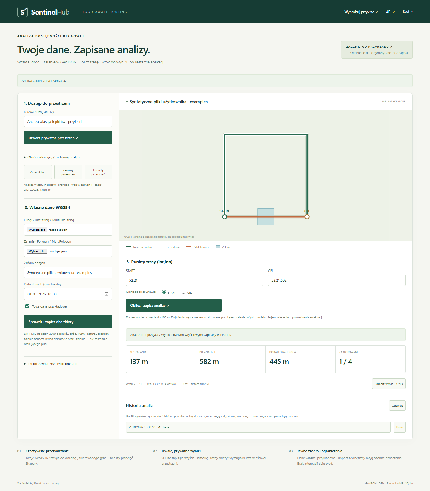

# SentinelHub · Flood-aware routing

Aplikacja do analizy dostępności drogowej: przyjmuje własne drogi i strefy
zalania w GeoJSON, oblicza najkrótszy przejazd z wyłączeniem zalanych odcinków
oraz trwale zapisuje dane i historię wyników. Każda przestrzeń ma prywatny klucz
właściciela. Opcjonalne importy OpenStreetMap i Sentinel Hub WMS wymagają
uprawnień operatora. Interaktywny przykład syntetyczny jest osobną funkcją.

**Python 3.12 · FastAPI · NetworkX · Shapely · SQLite · HTML/CSS/JavaScript/SVG**



## Główny przepływ

1. Utwórz przestrzeń i zapisz klucz do prywatnego pliku. Klucz jest potrzebny
   do ponownego otwarcia; nie jest przechowywany w przeglądarce ani adresie URL.
2. Wczytaj własne pliki GeoJSON dróg i zalania, podaj źródło i datę danych.
   Zapisz parę. Możesz zacząć od plików [examples](examples/README.md), zaznaczając
   ich syntetyczne pochodzenie. Aplikacja obsługuje inne geometrie użytkownika.
3. Wprowadź START i CEL jako `lat,lon` lub kliknij węzeł na schemacie sieci.
   Oblicz trasę. Zobacz porównanie długości, blokady lub brak połączenia.
4. Odczytaj zapisany wynik z historii, także po restarcie backendu. Pobierz JSON
   zawierający wynik i snapshot danych. Zmiana bieżących zbiorów nie zmienia
   wcześniejszych wyników.

Pod `/sample.html` jest niezależny, bezstanowy przykład. Jego reset nie usuwa
przestrzeni, danych ani historii. Schemat SVG rysuje geometrię zwróconą przez API;
nie pobiera kafelków i nie udaje aktualnej mapy terenowej.

## Uruchomienie lokalne

Wymagany Python 3.12. PowerShell:

```powershell
python -m venv .venv
.\.venv\Scripts\python.exe -m pip install -r requirements-dev.txt
$env:APP_MODE = 'application'
.\.venv\Scripts\python.exe -m uvicorn src.main:app --host 127.0.0.1 --port 8090 --limit-concurrency 16 --timeout-keep-alive 5
```

Linux:

```bash
python3.12 -m venv .venv
.venv/bin/python -m pip install -r requirements-dev.txt
APP_MODE=application .venv/bin/python -m uvicorn src.main:app --host 127.0.0.1 --port 8090 --limit-concurrency 16 --timeout-keep-alive 5
```

[Panel](http://localhost:8090), [API](http://localhost:8090/docs),
[readiness](http://localhost:8090/ready), [liveness](http://localhost:8090/health).
Dane: `data/sentinelhub.sqlite3`. `Ctrl+C` zatrzymuje proces. Nie usuwaj katalogu
`data`, jeśli chcesz zachować dane. Nie są wymagane klucze zewnętrzne do pracy
z własnymi plikami. Bez dostępu do Sentinel jego import zwróci błąd konfiguracji.

## Docker Compose / Raspberry Pi 5

```bash
cp .env.example .env
# PowerShell: Copy-Item .env.example .env
docker compose config --quiet
docker compose up --build -d --wait
DEMO_URL=http://127.0.0.1:8090 python3 tests/container_smoke.py
```

Na `luxonis` używaj `sudo docker compose` — odczyt wykazał, że `pi` nie ma
bezpośrednich praw do socketu Dockera. Domyślny projekt to `sentinelhub`, port
`127.0.0.1:8090`. API nie publikuje portu hosta. Dane w nazwanym wolumenie
`sentinelhub_sentinel-data` przetrwają restart i odtworzenie kontenerów.
Nie używa bazy, użytkowników ani wolumenów Nextcloud.

Obrazy Python i Nginx są przypięte digestami wieloarchitekturowych manifestów
z Linux ARM64. Wszystkie 22 zależności runtime pobrano jako koła zgodne z
CPython 3.12/aarch64. Build, 101 testów i działający stos wykonano również na Luxonis ARM64 — szczegóły
w [raporcie zgodności](docs/arm64-compatibility.json). Nie potrzeba GPU/CUDA.

**Wdrożono na Luxonis.** Build i testy kontenerów wykonano na serwerze ARM64.
Przygotowano CI z natywnym runnerem ARM64, ale jego wyniku nie potwierdzono.
Instrukcja dla serwera, backup, restore i rollback: [deployment.md](docs/deployment.md).

## Architektura i trwałość

```text
Przeglądarka → Nginx → FastAPI
                      ├─ klucz Bearer → autoryzacja przestrzeni
                      ├─ walidacja GeoJSON + wersja danych
                      ├─ SQLite: para zbiorów / snapshoty wyników
                      └─ NetworkX + Shapely: graf → baza → blokady → trasa

Operator + klucz przestrzeni → Overpass XML / Sentinel WMS
                            → walidacja → transakcyjny zapis w tej przestrzeni
```

SQLite jest wystarczający dla ograniczonego ruchu na jednym Raspberry Pi.
WAL, `synchronous=FULL`, klucze obce i transakcje zapewniają atomowość zapisu.
Numer `revision` chroni przed nadpisaniem cudzej równoczesnej zmiany. Jeśli dane
zmienią się podczas obliczenia, wynik nie zostanie zapisany pod błędną wersją.
Migracja v1 jest wykonywana przy starcie w transakcji. Nowszy, nieobsługiwany
schemat powoduje odmowę startu, a nie reset bazy.

Klucz właściciela ma 256 bitów losowości; baza przechowuje SHA-256 klucza.
Każdy odczyt, zmiana, usunięcie i dostęp do historii wymaga klucza tej przestrzeni.
To uwierzytelnianie przez posiadanie klucza, bez kont tożsamości i odzyskiwania
hasła. Zachowaj plik klucza; jego udostępnienie udostępnia dane. Klucz można
zrotować w panelu. Administrator systemu i posiadacz backupu mają dostęp do
plików bazy; szyfrowanie dysku/backupów pozostaje ustawieniem serwera.

Operacje są synchroniczne i ograniczone rozmiarem wejścia. Nie ma kolejki ani
fikcyjnego workera. Timeout odpowiedzi nie przerywa automatycznie wątku;
po timeout importu odczytaj przestrzeń przed ponowieniem. Nie ma automatycznych
ponowień kosztownych wywołań. Jeden worker Uvicorn utrzymuje wspólny limit
przetwarzania i importów w procesie.

## Kontrakt API

| Metoda | Ścieżka | Dostęp / działanie |
| --- | --- | --- |
| POST | `/api/workspaces` | Utworzenie ograniczonej przestrzeni; klucz tylko w tej odpowiedzi |
| GET / DELETE | `/api/workspaces/{id}` | Właściciel; odczyt / usunięcie tylko swojej przestrzeni |
| POST | `/api/workspaces/{id}/rotate-key` | Właściciel; unieważnienie starego klucza |
| PUT | `/api/workspaces/{id}/datasets` | Właściciel; atomowa para roads/flood z revision, source, observed_at, sample |
| POST | `/api/workspaces/{id}/analyses` | Właściciel; revision oraz start/end jako obiekty lat/lon |
| GET | `/api/workspaces/{id}/analyses` | Lista prywatnej historii |
| GET / DELETE | `/api/workspaces/{id}/analyses/{analysis_id}` | Właściciel; snapshot / usunięcie wyniku |
| POST | `/api/workspaces/{id}/imports` | Właściciel + `X-Admin-Key`; provider overpass/sentinel, bbox i revision |
| GET / POST | `/api/demo/scenarios`, `/api/demo/analyze` | Osobny syntetyczny przykład bez zapisu |

Prywatne żądania: `Authorization: Bearer <klucz przestrzeni>`. Swagger ma schemat
`WorkspaceKey`; import dodatkowo wymaga nagłówka operatora. Brak połączenia
w grafie to zapisany wynik `unreachable`, nie awaria. Statusy błędów: 401 błędny
klucz, 403 brak uprawnień operatora, 409 konflikt wersji / brak pary, 413 body,
422 walidacja, 429 przeciążenie, 502 upstream, 503 brak konfiguracji / magazynu,
507 limit przestrzeni. Szczegółowy kontrakt: `/openapi.json`.

## Limity i konfiguracja

| Parametr | Wartość / znaczenie |
| --- | --- |
| `APP_MODE` | `application` domyślnie: własne dane i trwałość; `demo`: tylko osobny przykład |
| `DATA_DIR` | Lokalnie `data`, w Compose `/app/data`; wyłącznie dane tego projektu |
| `WORKSPACE_DB_NAME` | `sentinelhub.sqlite3`; wybór innego, odtworzonego pliku bez nadpisywania aktualnego |
| `COMPOSE_PROJECT_NAME` / `DEMO_PORT` | `sentinelhub` / `8090`, loopback |
| `IMAGE_TAG` | `local`; na serwerze identyfikator wydania |
| `PUBLIC_URL` | Puste lokalnie; adres HTTPS z opcjonalnym prefiksem ścieżki, walidowany przy starcie |
| `ADMIN_API_KEY` | Opcjonalny losowy klucz operatora ≥32 znaki; wymagany do obu importów |
| `SENTINELHUB_INSTANCE_ID` | Aktywna instancja OGC z warstwą FLOOD; tylko backend |
| `SENTINELHUB_TIME_RANGE` | Zakres WMS YYYY-MM-DD/YYYY-MM-DD; domyślnie ostatnie 30 dni |
| `ALLOWED_ORIGINS` | Opcjonalny CORS; panel pracuje pod tym samym originem |

Stałe ograniczenia aplikacji: 100 przestrzeni, 8 MiB logicznych danych na przestrzeń,
do 10 snapshotów historii (starsze mogą ustąpić miejsca nowym), 1 MiB/500 features/
10000 współrzędnych na zbiór, 2000 odcinków drogowych, lokalna sieć do 0,5° na oś.
Import do 100 km² i 4 MiB odpowiedzi upstream. Body uploadu do 3 MiB, inne 4 KiB.
SQLite ma limit 65536 stron, około 256 MiB dla standardowych stron 4 KiB; WAL
oraz backupy zajmują dodatkowe miejsce i wymagają monitorowania.

Dwa miejsca przetwarzania, jeden import zewnętrzny, do 16 żądań Uvicorn.
Deadline odpowiedzi 75 s, odczyt body 5 s; przykład 10 s. Nginx 5 żądań API/s,
burst 15, tworzenie przestrzeni 1/min + burst 3. Za wspólnym proxy limity
obejmują jego adres do czasu poprawnej konfiguracji zaufanego real IP.
Compose: API do 512 MiB/1 CPU, web do 64 MiB/0,5 CPU; to limity, nie rezerwacja.
Nie deklarujemy, że dziesięć aplikacji zmieści się bez pomiarów na serwerze.

## Integracje i granice wyniku

Overpass jest rzeczywistym HTTP API bez klucza. Import wymaga operatora, by
anonimowe osoby nie generowały zewnętrznego ruchu. Zastane ID węzłów, kierunki
ruchu i ograniczenia dostępu są zachowane. Z całych dróg zwracanych przez
Overpass pozostają tylko odcinki wewnątrz wspólnego BBOX; odcinki przecinające
jego granicę są konserwatywnie odrzucane.

Sentinel wymaga aktywnego konta/limitu usługi i instancji WMS z warstwą FLOOD.
Repozytorium dostarcza rzeczywisty [evalscript](integrations/sentinel-water.js)
i [instrukcję konfiguracji](docs/sentinel.md). Jest to heurystyka powierzchniowej
wody, nie zweryfikowana detekcja powodzi ani ocena głębokości. Dane niewidoczne,
chmury i brak pokrycia mają dawać przezroczyste piksele; backend odrzuca raster
z choć jednym nieznanym pikselem. Nie zamienia braku danych na brak zalania.

Nie zweryfikowano realnego pobrania WMS z aktywnej, zrotowanej instancji.
Rzeczywisty import Overpass sprawdzono; niedostępność Sentinel pozostaje jawną
przeszkodą do pełnego przepływu obu zewnętrznych usług. Własne poprawne GeoJSON
nie wymagają żadnej z nich.

Brak ograniczeń skrętów, danych o ruchu, głębokości, oceny przejezdności mostów
oraz empirycznej walidacji maski wody. Snap do węzła do 100 m nie analizuje dojścia.
Odległość nie oznacza czasu przejazdu ani bezpieczeństwa. Źródło i datę uploadu
deklaruje użytkownik. WMS zapisuje zakres zapytania i czas pobrania; nie udaje
znanej daty obserwacji. To aplikacja analityczna, nie system prowadzenia ewakuacji.

## Sprawdzenia

Rekruter nie potrzebuje własnych GeoJSON: na stronie głównej wybiera
„Wczytaj przykład”, następnie „Oblicz i zapisz analizę”. Aplikacja tworzy
prywatną przestrzeń, zapisuje oznaczone dane syntetyczne i przygotowuje punkty.
Obliczenie i historia korzystają ze zwykłego backendu oraz SQLite. Przykładowe
pliki dróg i zalania są też dostępne do pobrania bezpośrednio ze strony.
Scenariusz bez własnych plików sprawdza `pnpm run test:recruiter`.

```bash
python -m pytest
python -m ruff check src tests
python -m ruff format --check src tests
python -m pip check
pnpm install --frozen-lockfile
pnpm exec playwright install chromium
pnpm run test:sentinel-script
# Przy działającym serwerze; ustaw DEMO_URL (PowerShell: $env:DEMO_URL=...)
DEMO_URL=http://127.0.0.1:8090 pnpm run test:workspace
DEMO_URL=http://127.0.0.1:8090 pnpm run test:browser
```

Historyczny audyt obejmował 101 testów Python, rzeczywiste UI desktop/mobile, restart procesu,
autoryzację, konflikty, zachowanie snapshotów i backup/restore. Przeprowadzono
pomiar lokalny oraz pomiar na Raspberry Pi (1740 odcinków, mediana 415 ms):
[project-audit.md](docs/project-audit.md). Testy nie podmieniają integracji
w aplikacji — mocki występują wyłącznie w testach awarii i walidacji.

Wdrożono na Luxonis ARM64 i sprawdzono przez publiczne HTTPS:
[otwórz aplikację](https://luxonis.tail6ad453.ts.net:8443/sentinelhub).
To stała ścieżka istniejącego Tailscale Funnel; nie wymaga VPN odwiedzającego. Własne pliki,
analiza, historia, eksport i dostęp kluczem działają. Potwierdzono odczyt po
restarcie i odtworzeniu kontenerów oraz backup/restore na serwerze.

**Pełny import Sentinel pozostaje zablokowany:** realne żądanie zwróciło błąd
wygaśnięcia konta; właściciel potwierdził potrzebę odnowienia. Starej wartości,
obecnej także w historii Git, nie skopiowano na serwer. Potrzebna jest nowa,
aktywna instancja OGC i warstwa FLOOD. Brak WMS nie jest zastępowany symulacją.

Kernel Luxonis nie obsługuje limitów RAM Dockera; deklarowane `mem_limit` nie
są egzekwowane. Limity CPU/PID i wejścia działają. `docker stats` pokazuje
niewiarygodne 0B pamięci, więc pomiar procesu wykonano osobno.
Nie zmieniano istniejących usług ani konfiguracji rozruchowej serwera.

Opis portfolio PL/EN: [portfolio.md](docs/portfolio.md). Fakty, ograniczenia
i instrukcja utrzymania: [audyt](docs/project-audit.md),
[wdrożenie](docs/deployment.md), [raport wdrożenia](docs/deployment-verification.md).

## Poprawki publicznej demonstracji — 22.10.2026

Stały adres `/sentinelhub/`, relatywne zasoby i API, uproszczony interfejs,
brak publicznych importów operatora. Nowe przestrzenie wygasają po 24 godzinach;
stare rekordy v1 zostają zachowane. Aktualny zestaw ma 110 testów Python.
Wyniki testów z niezależnej sieci są archiwizowane przez
[Public demo flows](https://github.com/Adam-Sapiecha/Portfolio-AdamSapiecha/actions/workflows/public-demos.yml).
Nie jest to potwierdzenie importu WMS ani klinicznej/ewakuacyjnej poprawności modelu.
